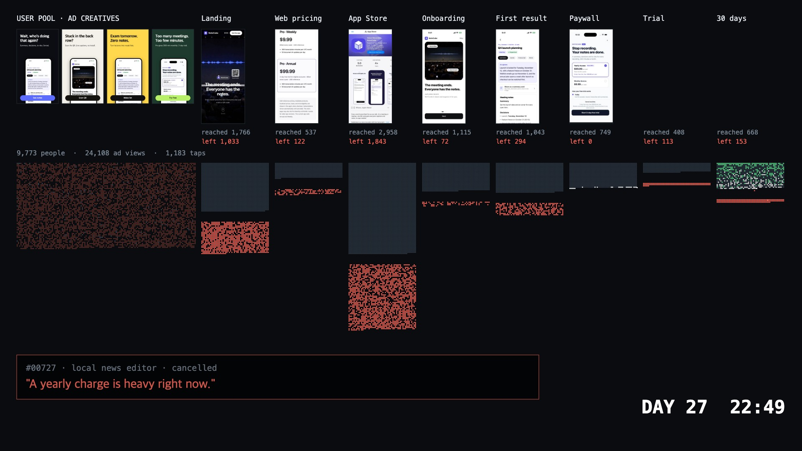

# SecondEarth Simulator

Fictional AI personas see your ad, walk your funnel, and decide to stay, pay, or leave over 30 simulated days. You watch them as dots and click any dot to read who that person is and why they stopped.



**This is a simulation, not a prediction.** Its accuracy has not been validated against real outcomes. Use it to find what to test next, not to forecast revenue.

## Quick start: replay without a key

Needs Node 22 or newer.

```bash
git clone https://github.com/secondearth-ai/simulator && cd simulator
npm install
npm start
```

Open http://127.0.0.1:4317. The server listens on 127.0.0.1 only.

This replays `runs/demo`: 1,000 fictional people (500 Korea, 500 US) going through the funnel of NoteCube, our own recording app. No API calls are made. Generating a person's thoughts or a diary of their day needs a key, and the demo ships without a report, so those parts stay empty until you add one.

The viewer and the prompts are in Korean today. An English UI is not built yet.

## Run it on your own product (bring your own OpenRouter key)

**Easiest:** start the server and open http://127.0.0.1:4317/new.html. Add your screens and prices, pick a persona set, and paste a key. A key typed there stays in the running job's memory and is never written to disk. This screen is limited to 2,000 people per run.

**From the command line:**

```bash
cp .env.example .env                                # add OPENROUTER_API_KEY
npx playwright install chromium-headless-shell
cp -r runs/demo runs/my-app && rm runs/my-app/walks.jsonl
# edit runs/my-app/run.json, replace runs/my-app/screens/<ko|en>/<stage>.jpg
node engine/capture.mjs my-app en landing=https://example.com pricing=https://example.com/pricing#800
node --env-file=.env engine/set.mjs my-set 1000     # optional, skip it to reuse sample-1000
node --env-file=.env engine/creatives.mjs my-app
node --env-file=.env engine/sim.mjs my-app
node --env-file=.env engine/report30.mjs my-app
node --env-file=.env server.mjs my-app
```

Runs resume: run `sim.mjs` again after a failure and it skips people who already finished. Lower or raise parallel calls with `CONC` (default 40).

**You must edit the prompts for another product.** The default stage texts in `engine/sim.mjs` describe a recording app, including "you made one recording" and "60 free minutes". In `run.json`, set `ask` and `acts` on each stage, plus `freeCheckAsk` and `creativeScreens`. The new-simulation screen writes these for you.

Current limits: the funnel ends in a paywall, trial, and renewal, so it assumes a subscription app. Ad rendering assumes Apple system fonts and may look different off a Mac.

## Reusing a persona set

A set in `sets/<id>/` holds people with no product information: job, workplace, income, daily schedule, commute, apps, subscriptions, tastes, regrets, how they talk. Point any run at one with `"set": "<id>"` in `run.json`. You pay to create a set once, and later products only pay for decisions.

`sets/sample-1000` is included. It was drawn with a fixed seed from our private 10,000-person set, keeping the same mix of sectors per country. We left out anyone whose text mentioned suicide, self-harm, psychiatric care, a diagnosis, religion, or politics, anyone with a social handle or link, and anyone with a real employer or school named in their job or workplace. It is not a representative sample, and the set's distributions are assumptions in code, not fitted to census data.

All people in this dataset are fictional and AI-generated. Any resemblance to real people is coincidental. Simulated results are not measurements of any real product.

## How a decision works

Each person sees the actual image, along with their own life and what they are doing at that hour, and the model returns a likelihood of moving forward. A seeded draw on that likelihood picks the action, and the matching reason is kept. Taking only the model's top choice would send almost everyone home.

**The prompts tell the model real-world base rates at each stage.** So results are anchored to these numbers, which are our rough assumptions:

| Stage | What the prompt says |
|---|---|
| Ad | People click 1 to 3 of 100 ads |
| Landing page | More than half close within seconds |
| App store page | About 30% install |
| Onboarding | About 60% get through |
| First result | Fewer than half keep using it |
| Paywall | About 5% start a trial or subscribe |
| End of trial | About a third pay |
| Weekly subscription | About half cancel within weeks |

Without these, personas behave far too eagerly. With them, the output cannot be read as independent evidence of those rates. What the personas add is the difference between groups, creatives, and screens, and the reasons they give.

## Pure and calibrated

- **Pure:** what the personas did, including the anchoring above. Useful for comparing creatives, screens, and audiences. Absolute rates and revenue run unrealistically high.
- **Calibrated:** you set each stage's rate with a gauge. A group's rate is the gauge multiplied by how far that group differs from everyone (capped between 0.2x and 3x), and the dots replay with only the most likely people moving forward at each stage. The gauge values are your inputs, so calibrated revenue is a scenario, not a finding. Replace the defaults in `run.json` with your own numbers.

## Limits

- Accuracy has not been validated. No result here has been compared with what real users went on to do.
- Personas are LLM output and share that model's biases. Some generated text is uneven, and reasons are cut at 30 characters.
- The NoteCube results in `runs/demo` are fictional. They say nothing about how real people respond to NoteCube.

## Cost

These are logged OpenRouter charges from one run at the default model, `qwen/qwen3.7-flash`.

| Step | Logged cost |
|---|---|
| Create 10,000 personas | $7.46 |
| Simulate 30 days | $1.099 at 6,500 people, about $0.17 per 1,000 |

The simulation figure comes from a progress line in the log, because that run did not log a final total. Report and thought generation costs were not logged. Ad copy uses `anthropic/claude-sonnet-5.5` and costs extra. Your cost will vary with image size and prices.

## Credits

We read [MiroFish](https://github.com/666ghj/MiroFish) to learn how it is structured. No MiroFish code is used here.

## License

Code is Apache-2.0. See [NOTICE](NOTICE) for what the license does not cover, including the NoteCube screens and ads in `runs/demo`.
